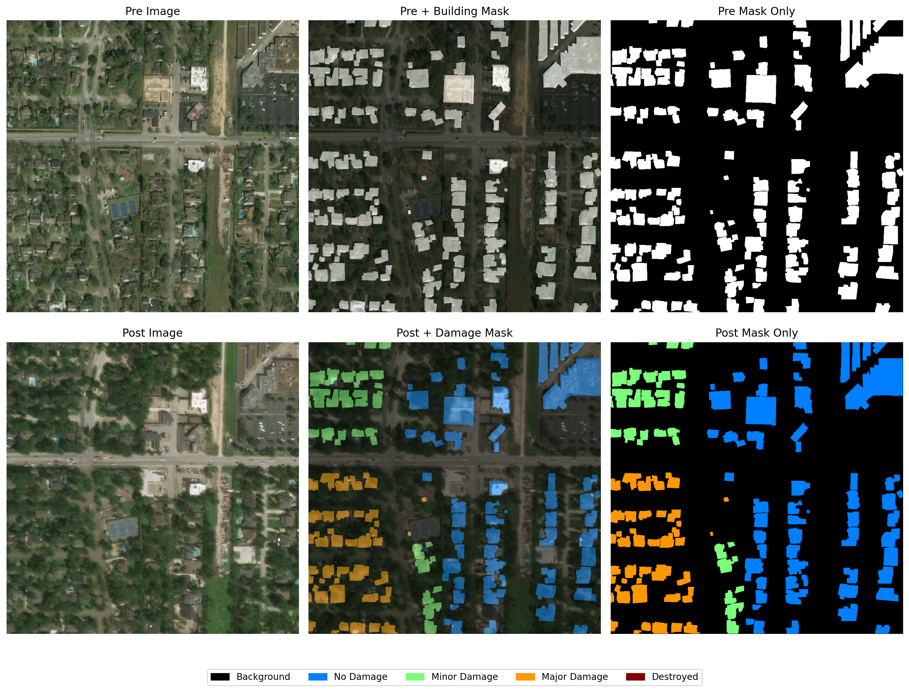
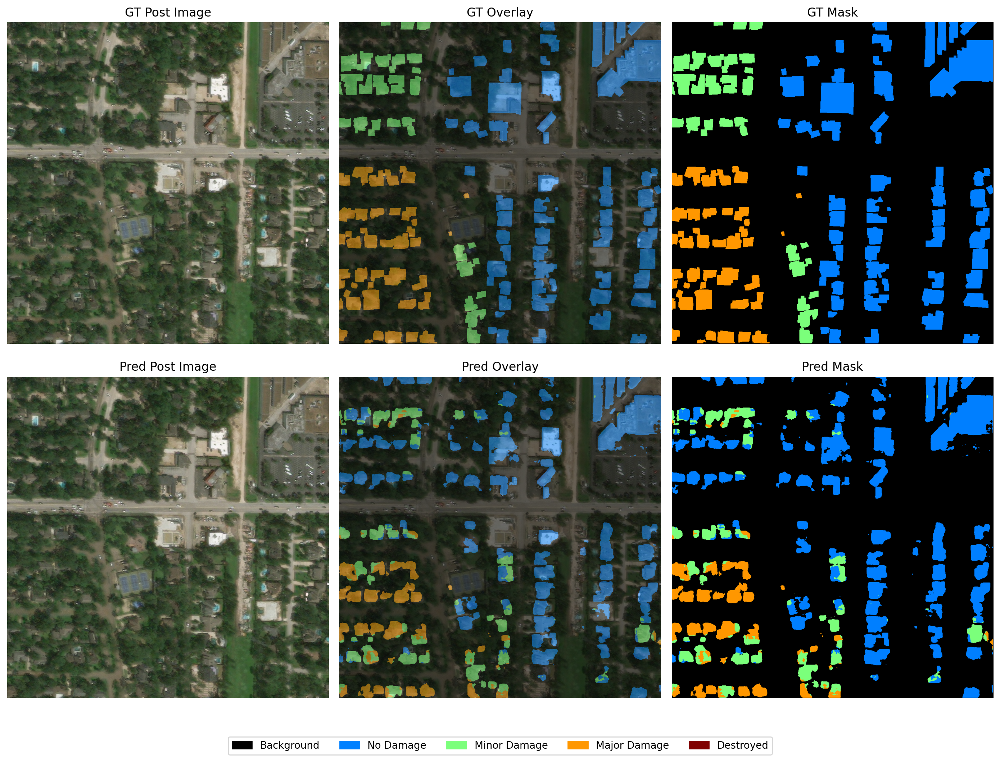

# xView2 Disaster Damage Assessment

Deep learning for building localization and structural damage classification from paired pre- and post-disaster satellite imagery.

This project was completed as part of the University of Virginia M.S. in Data Science deep learning curriculum using the [xView2](https://xview2.org/) disaster-damage dataset.

## Overview

The xView2 dataset contains paired satellite images captured before and after natural disasters, along with building footprints and damage labels. The project framed disaster assessment as two related computer-vision tasks:

1. **Building localization** — identify pixels belonging to buildings.
2. **Damage classification** — classify building pixels as no damage, minor damage, major damage, or destroyed.

Our four-person team compared multiple architectures:

- U-Net
- Siamese U-Net
- SegFormer
- DeepLabV3+

## My Contribution

I developed and evaluated the project's **dual-head U-Net** implementation.

The model concatenates the pre- and post-disaster RGB images into a **6-channel input** and passes them through a shared U-Net encoder-decoder. The final feature representation branches into two prediction heads:

- a binary building-localization head
- a 5-class damage head containing background plus four damage categories

The training objective combines:

- binary cross-entropy and Dice loss for building localization
- masked cross-entropy for damage classification, restricting the damage objective to building pixels

I also evaluated image augmentation and multiple input-resolution strategies. Experiments with 256, 384, 512, and 1024 pixel inputs showed that full-resolution 1024×1024 imagery performed best for the final U-Net.

## Results

The final U-Net achieved a **0.89 Dice score for building segmentation**, compared with 0.85 for the published baseline used in our report.

Among the four architectures evaluated by the team, U-Net produced the strongest building-localization performance, while SegFormer performed best on damage classification.

The results suggest that architectures optimized for precise spatial localization and those optimized for broader contextual classification may provide complementary strengths for disaster-damage assessment.

Below is an example of the output from the U-Net implementation, showing the before satellite imagery with ground-truth buildings on the top row and the after imagery with the predicted buildings and damage. It detects buildings well and does fairly well assessing damage level.

## Dataset

The full xView2 dataset contains:

- 11,034 pre/post image pairs
- 1024×1024 satellite imagery
- more than 850,000 annotated buildings
- disasters including hurricanes, earthquakes, floods, tornadoes, wildfires, and volcanic eruptions

Damage labels include:

- No damage
- Minor damage
- Major damage
- Destroyed

## Technologies

Python · PyTorch · NumPy · OpenCV · Albumentations · Matplotlib · SLURM / GPU Computing

## Repository Contents

- `patched_unet.py` — U-Net architecture, dataset loading, augmentation, training, and patching experiments
- `evaluation.py` — model evaluation utilities
- `Model_Analysis.ipynb` — model analysis and evaluation
- `Final_Project_Testing.ipynb` — final testing workflow
- `*.slurm` — GPU/HPC training scripts

## Team

Developed with Lucas Rayder, Nicholas Thornton, and Cole Whittington as a University of Virginia M.S. Data Science deep-learning project.

Each team member focused on one of the principal model architectures used in the comparison.
